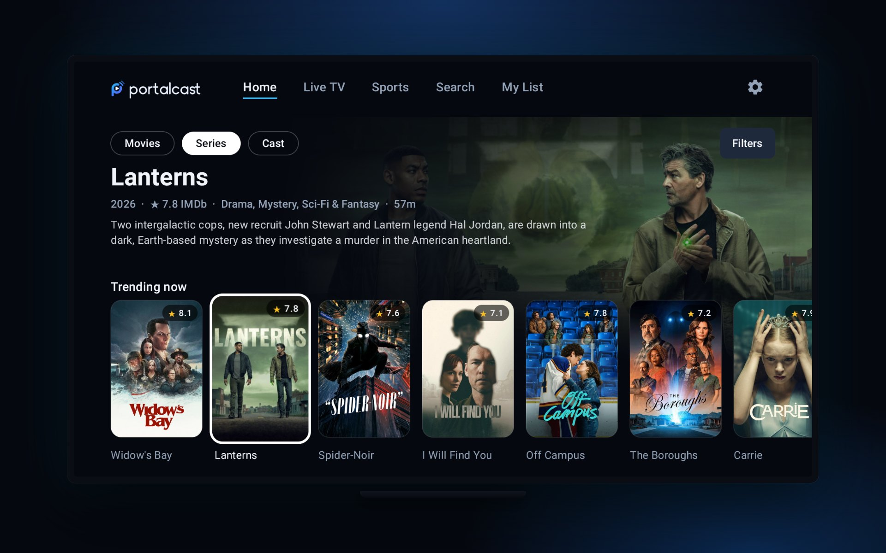
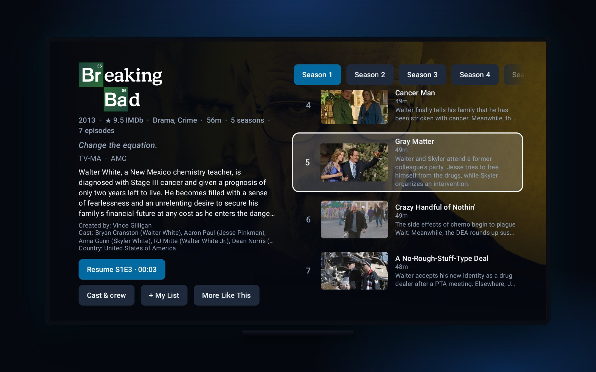

<p align="center">
  <picture>
    <source media="(prefers-color-scheme: dark)" srcset="docs/brand/portalcast-logo.svg">
    
  </picture>
</p>

<p align="center"><b>PortalCast for Android TV</b> is the native 10-foot app for PortalCast: your IPTV and your Jellyfin in one Home, built for the remote and fast on modest TV hardware.</p>

<p align="center">
  
  
  
  
</p>

<p align="center">
  <a href="https://portalcast.stream">Website</a> ·
  <a href="https://github.com/dhrumilshukla258/portalcast-tv-android/releases/latest">Download</a> ·
  <a href="https://github.com/dhrumilshukla258/portalcast-server">Server</a> ·
  <a href="https://github.com/dhrumilshukla258/portalcast-webui">Web app</a> ·
  <b>Android TV app</b>
</p>

---

<p align="center"></p>
<p align="center"></p>

<p align="center"><sub>Captured on a Hisense Google TV. Artwork and episode stills from TMDB.</sub></p>

## Features

- **The same app as the web**: Home, Live TV, Sports, Search and My List along the top, Movies · Series · Cast under it, in the black-blue PortalCast look. Movies and Series narrow Home to one type; the other brings both back.
- **Home made for each viewer**: the title to resume, Continue Watching, "Because you watched", top picks and trending, built from what this profile watched. One card per title across its language and quality versions, with your Jellyfin copy on the same card. It opens at once on the Home it showed last.
- **Filters**: genre, language, country, channel or platform and mood, plus the provider's **IPTV categories** and **My library** (your Jellyfin's films and shows).
- **Hold OK on a title** to add it to My List, mark it watched, say "Not interested" (it leaves every Home row) or remove it from Continue Watching. **My List** keeps My List, Watched, Not interested and favourite channels, so anything can be undone.
- **Cast**: actors, actresses, directors, creators and writers with photos, ranked by what the profile watches, each with every title of theirs you have.
- **Sports**: the next 30 days of the sports each viewer picks, with the channel showing each match from the TV guide; OK on a match tunes in.
- **Series** laid out like Netflix: the show and its seasons on the left, episodes with stills and descriptions on the right, opening on the episode you are watching.
- **Live TV** with now and next from the guide, favourites and recent channels.
- **Player**: resume, a next-episode prompt, a Jellyfin-style control row (Up/Down) with subtitle (CC) and audio popups, and the real resolution and frame rate in the overlay. Subtitles come from OpenSubtitles, SubDL, Gestdown and Jellyfin, or the file's own tracks, with per-title timing; the app remembers your pick per title. Audio the TV can't decode (DTS, TrueHD) is decoded by the app.
- **Your own player**: Settings › Player hands every title to VLC, MX Player, Just Player or any other player, or asks each time.
- **Built for the remote**: every screen works with the d-pad alone, focus is remembered per row, and grids keep your column however fast you scroll.
- Sign in with a pairing code from your phone; progress, My List and favourites sync with the web app.

## Install

1. Run a [PortalCast Server](https://github.com/dhrumilshukla258/portalcast-server).
2. Download `portalcast-tv-<version>.apk` from the [latest release](https://github.com/dhrumilshukla258/portalcast-tv-android/releases/latest) and sideload it (for example with the Downloader app, or `adb install`).
3. Open PortalCast, enter your server address (`192.168.1.10:3000` or `https://tv.example.com`) and approve the code it shows from the web app.

Works on Android TV and Google TV devices running Android 5.0 or later; a phone works for testing. To update, install the newer APK over the old one: you stay signed in.

## Build

```bash
./gradlew assembleRelease testDebugUnitTest   # JDK 17, Android SDK 34
```

Unit tests run as `testDebugUnitTest`, as in CI: the screen tests need the Compose test manifest, which only the debug build has. `local.properties` points at your SDK (`sdk.dir=C:/path/to/Sdk`, forward slashes). Release signing reads `PORTALCAST_KEYSTORE`, `PORTALCAST_KEYSTORE_PASSWORD`, `PORTALCAST_KEY_ALIAS` and `PORTALCAST_KEY_PASSWORD`; without them the build is debug-signed. A `v*` tag builds and tests the signed APK on GitHub and attaches it to the release.

## Docs

- [docs/api-contract.md](docs/api-contract.md): every server call the app makes, field by field
- [docs/architecture-plan.md](docs/architecture-plan.md): design and package layout
- [docs/design-system.md](docs/design-system.md): the look and the layout rules, shared with the web app
- [docs/test-checklist.md](docs/test-checklist.md): manual checks on a TV
- [CLAUDE.md](CLAUDE.md): rules that are easy to get wrong

## Disclaimer

PortalCast is software only. It does not provide, host or distribute any content; you connect it to a provider you are entitled to use and, if you like, to your own Jellyfin server. PortalCast is not affiliated with Jellyfin.

## License

MIT, see [LICENSE](LICENSE).
